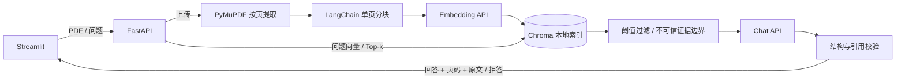

# Investment Research RAG · 投研文档问答

Evidence-grounded financial document QA with FastAPI, LangChain, Chroma, and Streamlit, featuring citation validation and retrieval evaluation.

上传公开企业年报 PDF，按页提取文本并建立本地向量索引，依据检索证据回答问题。回答附带文档名、**PDF 物理页码**和可核验的原文摘录；证据不足或引用校验失败时明确拒答。

**Python 3.11 · FastAPI · LangChain · Chroma · PyMuPDF · Streamlit · OpenAI-compatible API**

这是面向 localhost 的研究演示，包含离线测试、冻结的真实 API 评测及失败案例分析。没有模型微调、认证或生产部署功能。

## 演示

当前选定实现默认使用 **Dense Top-5、余弦阈值 0.35、最多 16,000 个上下文字符**。截图来自实际运行，展示完整回答、物理页码和原文引用。


Phase 2 历史截图：[问答](docs/demo-qa.jpg) · [指标](docs/demo-evaluation.jpg) · [物理页预览](docs/demo-preview.jpg)。历史截图中的指标不代表 Phase 3 当前结果。

## 快速开始

已验证环境：**WSL Ubuntu / Python 3.11**。以下为 Bash 命令。需要 [Git](https://git-scm.com/downloads) 和 [uv](https://docs.astral.sh/uv/getting-started/installation/)，模型问答还需要可用的 chat 与 embedding API。

计划发布到 `Julien5451/investment-research-rag`。仓库创建并推送后可运行：

```bash
git clone https://github.com/Julien5451/investment-research-rag.git
cd investment-research-rag
uv sync --python 3.11 --extra dev --extra demo --locked
test -f .env || cp .env.example .env
```

编辑 `.env`，填写 `CHAT_API_KEY` 与 `EMBEDDING_API_KEY`。两类模型的 provider、base URL、model 和 key 可分别配置，完整字段见 [.env.example](.env.example)。密钥只由后端读取，不填入 Streamlit 页面。

终端一，启动 API：

```bash
DATA_DIR=./data/demo COLLECTION_NAME=demo \
  uv run --locked uvicorn research_qa.main:app \
  --host 127.0.0.1 --port 8000 --workers 1
```

终端二，在同一仓库目录启动界面：

```bash
QA_API_URL=http://127.0.0.1:8000 \
  uv run --locked --extra demo streamlit run streamlit_app.py \
  --server.address 127.0.0.1 --server.port 8501
```

打开 [Streamlit](http://localhost:8501)，上传 PDF，等待索引完成后提问并展开引用。也可通过 [FastAPI 文档](http://localhost:8000/docs) 测试接口。日常演示不需要恢复历史评测索引，使用独立的 `data/demo` 存储。

`uv.lock` 固定依赖解析结果，`--locked` 在项目与锁文件不一致时失败。pip 替代方式：创建 Python 3.11 虚拟环境后运行 `python -m pip install -e '.[dev,demo]'`；该方式不使用 uv 锁文件。已有 WSL `.venv` 不能直接用于 Windows 原生 Python。

无需 API key 的离线验证命令见下方“测试与发布检查”。

## 功能与架构

- **上传与入库**：校验文件类型、字节数、页数和提取文本预算；服务端 UUID 保存文件。
- **检索**：PyMuPDF 按物理页提取，LangChain 在单页内分块，Chroma 持久化余弦向量索引。
- **问答与引用**：Top-k 检索、阈值过滤、受限上下文；服务端验证 source ID 和逐字摘录。
- **演示与评测**：问答历史、拒答状态、引用和本会话 PDF 页预览；独立评测索引、逐题输出、复核记录及汇总。



```text
src/research_qa/       # API、配置、解析、索引、检索、问答和评测模块
streamlit_app.py      # 演示入口
tests/                # 离线单元和集成测试
scripts/              # 公共语料准备、诊断、索引恢复、实验及发布检查
eval/dataset.json     # Apple 固定开发题集
eval/results/         # Phase 2 原始结果与逐题复核
eval/phase3/          # 证据标注、冻结快照、检索实验、配对 A/B 与 holdout
docs/                 # 架构、结果分析、截图、简历项目材料和发布审阅
```

详细职责和信任边界见 [架构文档](docs/architecture.md)。分层参考官方 [langchain-ai/rag-from-scratch](https://github.com/langchain-ai/rag-from-scratch)，服务代码独立编写。

## 评测结果

真实模型使用 `gpt-4o-mini` 与 `text-embedding-3-small`。Apple FY2025 开发集有 **24 条唯一题目：18 条可回答、6 条应拒答**，共 467 个 chunks。Phase 2 数据集与历史结果保持原样。

| 实验 | Baseline | Selected | 范围 |
| --- | ---: | ---: | --- |
| Phase 2 总体任务正确率 | 54.17%（13/24） | 70.83%（17/24） | 严格引用匹配 → 仅兼容排版空白的匹配 |
| Phase 3 开发集总体正确率 | 70.83%（51/72） | 83.33%（60/72） | 同一批 24 题，3 组配对重复；共 144 次问答执行 |
| Phase 3 开发集可回答题正确率 | 61.11%（33/54） | 77.78%（42/54） | 误拒答计错 |
| Phase 3 开发集误拒答率 | 33.33%（18/54） | 22.22%（12/54） | 分母为可回答题 |
| Evidence Recall@k | 66.67%（12/18） | 72.22%（13/18） | Dense Top-3 → Top-5，完整证据组合标注 |
| Costco 独立公司 holdout 正确率 | 66.67%（8/12） | 83.33%（10/12） | 各运行一次：9 条可回答、3 条应拒答 |

Phase 3 的 selected 是 **Top-5 + 通用完整性/表格原文复制提示**的组合干预，引用验证没有放宽。BM25 + Dense RRF 没有增加已核验证据召回，因此在线默认路径仍是 Dense。Top-5 的实际平均上下文比 Top-3 多约 60.3%，不能把变化归因于单一因素。

开发集 selected P50/P95 为 **1.893/2.905 秒**，baseline 为 1.783/2.520 秒；holdout selected 为 **1.973/4.251 秒**，baseline 为 2.235/3.066 秒。延迟包括 query embedding、检索、生成和校验，不包含 HTTP/UI 与文档入库，是当次服务和网络条件下的观测。

这些是小样本、代理辅助非盲复核的观测，没有统计显著性或一般化保证。三次重复不等于 72 条独立题目。Holdout 在配置选定后运行，未用于返回调参；其 Evidence Recall 没有完整标注，记为 **unavailable**。正确拒答也不能代表系统整体可靠性。

可核验记录：[Phase 2 分析](docs/evaluation_analysis.md) · [Phase 3 报告](docs/phase3_results.md) · [开发集逐题对比](eval/phase3/comparison.md) · [Holdout 对比](eval/phase3/holdout/comparison.md) · [证据标注说明](eval/phase3/evidence_notes.md)。所有逐次原始回答、复核、耗时和冻结快照均随仓库保留。

## 新克隆恢复评测资源

PDF、数据库、向量索引和 query cache 不提交。先下载并核验固定公共报告（不调用模型）：

```bash
uv run --locked python scripts/prepare_eval.py
uv run --locked python scripts/prepare_eval.py \
  --dataset eval/phase3/holdout_dataset.json --pdf-dir eval/pdfs
```

下载脚本检查 SHA-256、物理页数和 gold 引文。来源分别为 [Apple FY2025 10-K](https://s2.q4cdn.com/470004039/files/doc_financials/2025/ar/_10-K-2025-As-Filed.pdf) 和 [Costco FY2025 年报](https://s201.q4cdn.com/287523651/files/doc_financials/2025/ar/COST-Annual-Report-2025.pdf)。公开下载不代表项目对第三方报告授予再分发许可。

恢复 Apple 评测索引需要配置与历史记录一致的 **embedding provider、base URL 与 model**，并会产生 embedding API 用量：

```bash
uv run --locked python scripts/phase3_setup.py --rebuild-index
```

该步骤不调用 chat，不重新执行历史 A/B；先验证冻结产物、provider/model 指纹及全部 467 个 chunk 的 ID、metadata 和文本哈希，再重建向量。复用的本地索引也会核验完整 corpus。现有索引及不完整目录均不会被静默覆盖。日常问答可自行选择兼容服务，但任意服务不一定能通过历史索引的指纹检查。

新 API 调用不能保证逐字重现历史生成。完整复跑应使用新输出目录，保留已选配置与冻结快照；具体命令及 holdout 限制见 [Phase 3 复现说明](docs/phase3_results.md)。该文档也保留首次实验的历史命令，不应在已有结果目录上重新运行冻结、诊断或比较脚本。

通用评测器的新运行示例（调用真实 chat/embedding；输出目录必须尚不存在）：

```bash
uv run --locked python -m research_qa.evaluation \
  --dataset eval/dataset.json --pdf-dir eval/pdfs --output .release/evaluation/my_run
```

Streamlit 优先读取 Phase 3 selected 汇总，缺失时回退到 Phase 2 `latest`。保留原始 `eval/results/`，不要覆盖或向其中添加新 run，否则冻结清单校验会失败；新运行通过独立目录及评测器查看。

## 测试与发布检查

```bash
uv run --locked --extra dev --extra demo pytest -q
uv run --locked --extra dev --extra demo ruff check src tests streamlit_app.py scripts
uv run --locked --extra dev --extra demo ruff format --check src tests streamlit_app.py scripts
uv run --locked python scripts/check_publishable.py
```

离线测试使用生成的 PDF、临时真实 Chroma、可控向量和模拟 chat/HTTP，不需要 API key 或下载公开语料。Phase 3 历史验证为 224 项测试通过，详见原始 [验证记录](eval/phase3/final_verification.json)。本次发布检查单独记在 [发布审阅](docs/publication_review.md)，不改写历史验证结果。

发布脚本使用临时 Git 环境核验实际忽略规则和 checkout 字节保护，不在项目中初始化 Git；输出默认为被忽略的 `.release/publishability.json`。扫描覆盖配置密钥值和常见 key 模式，仍需人工审阅文件与截图。拟提交的完整清单见 [release_files.txt](docs/release_files.txt)。

## 配置、接口与数据边界

`openai` provider 要求对应 API key；`openai-compatible` 可用于无需认证的本地服务，需要标准 `/chat/completions` 和 `/embeddings` JSON API，chat 模型须遵守 JSON 输出约定。`QA_API_URL` 由 Streamlit 的 shell 环境读取。启动和 `/health` 不调用远程模型，health 可读不代表远程模型在线。

更换 embedding 的 provider、base URL 或 model 后，需使用新的 `COLLECTION_NAME` 或 `DATA_DIR` 并重新上传 PDF；已有 collection 会拒绝不匹配的指纹。启动示例中的行内 `COLLECTION_NAME=demo` 会覆盖 `.env`，更换时也要修改该命令。只更换 chat 配置不需要重建索引。

| 接口 | 输入 | 输出 |
| --- | --- | --- |
| `POST /documents` | multipart `file` | 文档 ID、文件名、物理页数、chunk 数 |
| `POST /ask` | `question`，可选 `top_k`（1–20，默认 5） | 答案、拒答状态、引用和原因 |
| `GET /health` | 无 | 本地状态、索引 chunk 数 |

```bash
curl -s http://localhost:8000/ask \
  -H 'Content-Type: application/json' \
  -d '{"question":"What was the reported revenue?"}'
```

引用包含 `document_name`、`page`、`chunk_id`、`quote` 和 `relevance_score`；页码从 1 开始，包含封面/空白页，不是印刷页码。逐字匹配只兼容连续空白/换行差异，数字、标点、大小写和顺序必须一致；返回 source 中连续的真实摘录，不拼接不同 chunks。余弦相关度不是答案正确概率。

默认单 PDF 上限 20 MiB、500 页、2,000,000 个提取字符；问题最多 4,000 字符。证据不足、非法模型输出或引用失败时返回 HTTP 200、`abstained: true` 与原因。类型错误为 415、过大为 413、非法 PDF/字段为 422、模型服务错误为 502；错误不暴露上游原始内容或密钥。

本地 `data/` 保存上传 PDF 与 Chroma 文本/向量，均被忽略；Chroma 匿名遥测关闭。单数据目录只使用一个服务进程、一个 worker。上传异常会尝试回滚，进程崩溃仍可能残留不完整数据；重复上传会新建文档身份，暂无删除/更新接口。

`.gitignore` 排除凭据、所有 PDF、本地数据库、缓存和实验 workspace。`.gitattributes` 对普通文本使用 LF；冻结数据、评测产物及记录哈希的 pipeline 源码使用 `-text`，保持字节哈希。

## 局限

- 没有 OCR、图表理解或表格结构重建；字符分块可能切断年份、单位和财务行上下文。
- 指令过滤、证据边界与引用检查是基础防护，不能覆盖全部提示注入；引文存在也不能证明解释、财务口径或推理正确。
- 解析在服务进程内执行，没有硬 CPU/内存沙箱；同步入库和进程锁限制并发。
- 文档文本与问题会发送给配置的 API 服务商，本地文件和索引没有应用层加密。没有认证、多租户与生产部署支持。
- 目前只在少量公开年报题目上评测，仍有检索遗漏、误拒答、表格证据不完整及多部分答案缺漏。不能用于自动投资决策。

求职项目表述与可核验的指标见 [简历项目材料](docs/resume.md)。
