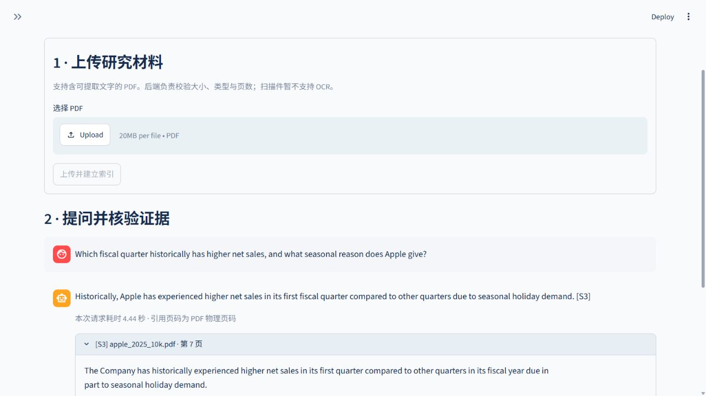
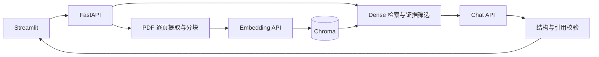

# Investment Research RAG · 投研文档问答

上传企业年报 PDF，检索文档证据并生成附带原文引用的回答。每条引用包含文档名、**PDF 物理页码**和原文摘录；证据不足或引用不可验证时明确拒答。

**Python 3.11 · FastAPI · LangChain · Chroma · PyMuPDF · Streamlit**

面向 localhost 的 RAG 工程实践项目，覆盖 PDF 入库、持久化检索、引用校验、接口与交互演示，以及可追溯的评测和失败分析。



## 核心功能与架构

- **PDF 入库**：逐物理页提取文本，单页内分块，保存来源元数据和本地向量索引。
- **证据检索**：默认 Dense Top-5、余弦阈值 **0.35**，上下文上限 **16,000 字符**。
- **回答与引用**：结构化生成，严格校验 source ID 与连续原文；只兼容排版空白差异，返回原始摘录。非连续支持片段分别引用。
- **演示与评测**：FastAPI 接口、Streamlit 问答和页面预览；保留逐题响应、复核记录、冻结快照和历史指标。



## Quick Start

已验证环境：**WSL Ubuntu / Python 3.11**。以下为 Bash 命令，需要 Git、[uv](https://docs.astral.sh/uv/getting-started/installation/) 和可用的 chat / embedding API。

```bash
git clone https://github.com/Julien5451/investment-research-rag.git
cd investment-research-rag
uv sync --python 3.11 --extra dev --extra demo --locked
test -f .env || cp .env.example .env
```

编辑 `.env`，填写 `CHAT_API_KEY` 与 `EMBEDDING_API_KEY`；provider、base URL 和 model 可分别配置，见 [.env.example](.env.example)。默认模型为 `gpt-4o-mini` 和 `text-embedding-3-small`。上传和问答会调用配置的服务并可能产生费用。

终端一，在仓库目录启动后端：

```bash
DATA_DIR=./data/demo COLLECTION_NAME=demo \
  uv run --locked uvicorn research_qa.main:app \
  --host 127.0.0.1 --port 8000 --workers 1
```

终端二，在同一仓库目录启动前端：

```bash
QA_API_URL=http://127.0.0.1:8000 \
  uv run --locked --extra demo streamlit run streamlit_app.py \
  --server.address 127.0.0.1 --server.port 8501
```

打开 [Streamlit](http://localhost:8501)，首次上传 PDF 后提问并展开引用；接口可在 [FastAPI 文档](http://localhost:8000/docs) 查看。演示使用独立的 `data/demo`，无需恢复历史评测索引。

- **索引持久化**：重启或刷新页面不会清空后端索引，已入库 PDF 无需重新上传。当前重复上传会产生不同文档 ID 的重复数据，可能挤占 Top-k 名额。
- **端口冲突**：可调整后端 `--port` 或前端 `--server.port`；`QA_API_URL` 必须指向实际后端地址和端口。
- **进程与环境**：每个数据目录只运行一个后端进程、一个 worker；WSL 的 `.venv` 不能直接供 Windows 原生 Python 使用。

离线检查使用生成的 PDF、临时索引和模拟模型，不调用真实模型 API：

```bash
uv run --locked --extra dev --extra demo pytest -q
uv run --locked --extra dev --extra demo ruff check src tests streamlit_app.py scripts
uv run --locked --extra dev --extra demo ruff format --check src tests streamlit_app.py scripts
```

## 历史评测摘要

以下结果对应 **Phase 2/3 冻结版本**，模型为 `gpt-4o-mini` 与 `text-embedding-3-small`。**本次非连续引文提示补丁后，没有重跑 Apple / Costco 评测，不能将这些数字视为当前补丁的新成绩。**

| 历史实验 | Baseline | Selected | 样本与口径 |
| --- | ---: | ---: | --- |
| Phase 2 Apple 总体任务正确率 | 54.17%（13/24） | 70.83%（17/24） | 24 题，各一次；仅放宽排版空白匹配 |
| Phase 3 Apple 开发集总体任务正确率 | 70.83%（51/72） | 83.33%（60/72） | 24 道唯一题，每版本重复 3 次 |
| Phase 3 Evidence Recall@k | 66.67%（12/18） | 72.22%（13/18） | 18 道可回答题；Dense Top-3 → Top-5 |
| Phase 3 Costco 历史 holdout 总体任务正确率 | 66.67%（8/12） | 83.33%（10/12） | 12 题，每版本各一次 |

总体任务正确率包含正确拒答，误拒答计错。Phase 3 Selected 是 **Top-5 + 通用提示调整**的组合，不能归因于单一因素。样本小、复核为代理辅助非盲复核，重复执行不等于新增独立题目；这些结果不提供一般化或生产可靠性保证。完整口径与复现依据见 [Phase 2 分析](docs/evaluation_analysis.md) 和 [Phase 3 报告](docs/phase3_results.md)。

Microsoft 的后续调试与用户手工回归单独记在 [手工验收记录](docs/manual_acceptance.md)，不混入历史指标；该题集已用于调试，属于开发/回归集。

## 已知限制

- 财务表格可能出现“命中正确页，但漏掉包含金额、年份或单位的关键块”；没有 OCR、图表理解或表格结构重建，仍可能误拒答。
- 引文能匹配原文，不代表答案的语义、财务口径或完整性正确。引用校验与提示注入防护都有边界。
- 上传流程尚无重复防护和文档删除/更新接口，页面对后端持久化状态的提示也不充分。
- 文档文本和问题会发送给配置的 API 服务商；本项目无认证、多租户或生产部署支持，不用于自动投资决策。

## 详细文档与许可

- [架构、接口边界与技术取舍](docs/architecture.md)
- [Microsoft 手工验收、引用修复与已知问题](docs/manual_acceptance.md)
- [Phase 3 完整实验、复现与历史验证](docs/phase3_results.md) · [开发集逐题对比](eval/phase3/comparison.md) · [历史 holdout 对比](eval/phase3/holdout/comparison.md)
- [历史发布审阅与检查流程](docs/publication_review.md) · [简历项目材料](docs/resume.md)

代码采用 [MIT License](LICENSE)。第三方年报的权利归原权利人；PDF、凭据、本地数据库和临时产物不随仓库提交。
