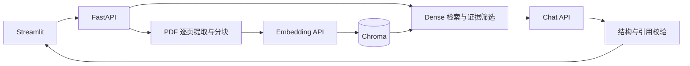

# Investment Research RAG · 投研文档问答

上传企业年报 PDF，检索证据并回答问题，附文档名、PDF 物理页码和原文摘录；证据不足或引用不可验证时拒答。

Python 3.11 · FastAPI · LangChain · Chroma · PyMuPDF · Streamlit


## 功能与架构

- 按 PDF 物理页提取和分块，保留来源页码。
- Chroma 持久化检索，默认 Dense Top-5，相关度阈值 0.35。
- 生成原文引用，校验 source ID 和连续摘录，多段证据分别引用。



## Quick Start

以下命令在 WSL Ubuntu 的 Bash 中执行，需先安装 Git。

```bash
# 未安装 uv 时执行下面两行
curl -LsSf https://astral.sh/uv/install.sh | sh
source "$HOME/.local/bin/env"
git clone https://github.com/Julien5451/investment-research-rag.git
cd investment-research-rag
uv sync --python 3.11 --extra dev --extra demo --locked
test -f .env || cp .env.example .env
```

编辑 `.env`，填写 `CHAT_API_KEY` 和 `EMBEDDING_API_KEY`。默认模型为 `gpt-4o-mini`、`text-embedding-3-small`，其他配置见 [.env.example](.env.example)。上传和问答会调用配置的 API，可能产生费用。

终端一，在仓库目录启动后端：

```bash
DATA_DIR=./data/demo COLLECTION_NAME=demo \
  uv run --locked uvicorn research_qa.main:app --host 127.0.0.1 --port 8000 --workers 1
```

终端二，在同一目录启动前端：

```bash
QA_API_URL=http://127.0.0.1:8000 \
  uv run --locked --extra demo streamlit run streamlit_app.py --server.address 127.0.0.1 --server.port 8501
```

打开 [Streamlit](http://localhost:8501)，上传 PDF 后提问并展开引用。后端索引会保留，刷新或重启页面后无需重复上传。

## 评测

| 项目 | 结果 | 范围 |
| --- | --- | --- |
| Apple 开发集（任务正确率） | 70.83% → 83.33% | 同一 24 题，3 轮配对重复测试 |
| Costco 留出集（正确题数） | 8/12 → 10/12 | 配置冻结后的 12 题留出测试 |
| 自动化测试 | 230 项通过 | 最近一次离线验证，使用模拟模型 |

历史结果按基线 → 选定配置列出，来自冻结版本的小样本 AI 辅助复核，最新引用提示补丁后未重新评测。

## 已知限制

财务表格可能漏检关键证据；原文匹配不能完全保证答案语义正确或完整；重复上传尚无去重，可能挤占检索名额。

文档：[架构设计](docs/architecture.md) · [评测与复现](docs/phase3_results.md) · [MIT License](LICENSE)
