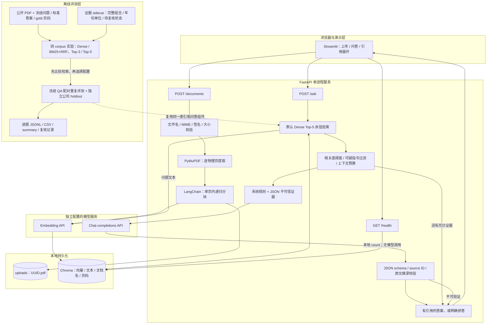
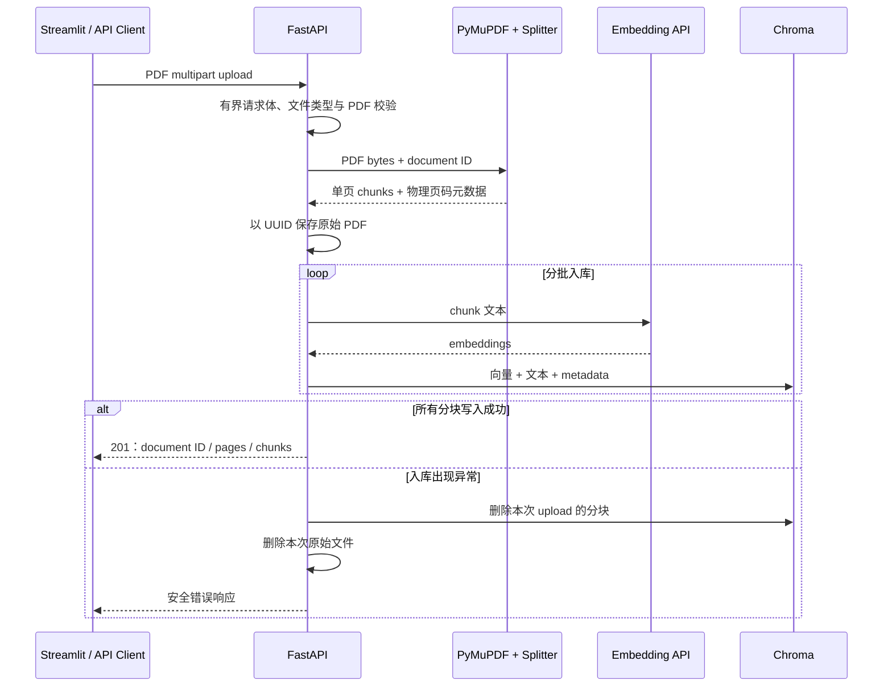

# 项目架构与技术取舍

本项目将“文档入库”和“问题回答”分开，底层共用带页码元数据的持久化向量索引。Streamlit 只通过 HTTP 调用 FastAPI；模型凭据保留在后端配置中。

## 系统架构图



图中的评测 CLI 复用 Python 组件运行独立索引；它不依赖正在运行的 FastAPI HTTP 服务。演示层与评测层不会自动共享数据目录。

BM25/RRF 是可选研究分支，复用同一 Chroma 中的原文、metadata、chunk ID 和已有向量；在线默认路径仍是 `VectorIndex.search`。BM25 没有独立数据库或外部搜索服务。

## 上传流程



文档名只用于展示，原始文件以 UUID 命名，避免客户端路径进入存储路径。分块绝不跨页，使一个 chunk 对应一个明确的物理页；空白页不产生 chunk，但保留在页码计数中。

每个 chunk 的核心元数据：

| 字段 | 用途 |
| --- | --- |
| `document_id` | 本次上传的服务端身份；评测器使用可复现的文件内容身份 |
| `document_name` | 用户可读的来源名称 |
| `page` | 1-based PDF 物理页码 |
| `chunk_id` | 文档、页码与分块序号组成的唯一身份 |
| `start_index` | 分块在对应页提取文本中的起点 |

## 问答流程与可信边界

1. 对问题生成 embedding，取原始 Top-k chunks。
2. 应用相关度阈值、可疑指令模式过滤和上下文字符预算。
3. 将系统规则与 JSON 证据数据分离。问题、文档名和文档正文都不能提升为系统指令。通用提示要求在 claim 文本中覆盖问题明确请求的各部分，并对财务表格复制连续原文，不把解释性标签插入 quote。
4. Chat 模型按约定 JSON schema 返回 claims 和每条 claim 的 evidence。
5. 服务器核验 source ID 属于本次上下文，quote 与该 source 中的连续文本相符。只容忍连续空白/换行的差异，数字、标点、大小写和词序不变；通过位置映射返回原始摘录，再从索引读取真实文档名和页码。
6. 生成 `[S1]` 标记及引用列表；证据不足、模型自报不足或输出不可验证时拒答。

相关度阈值是检索门槛，不能替代事实判断。原文摘录验证保证“摘录可在所引用片段找到”，并不保证 claim 在语义上由摘录推出。系统不具备财务审计或投资建议审核能力。

本阶段没有默认启用 citation-repair retry，也没有为每次请求增加第二次 LLM 调用。缺失总额而仅有部分组成行时，修补为真实 cash-row 引文仍可能掩盖错误总额；当前没有通用语义安全判定保证这种修复，因此继续显式拒答。

Streamlit 默认 Top-k 与选定配置对齐为 5；评测卡片优先读取 Phase 3 optimized 的汇总，缺少该文件时回退到有明确阶段标签的 Phase 2 记录。展示 Evidence Recall@selected k、唯一题目数与重复执行数，不把页召回或重复题数作为证据质量/新样本数。

## 模块映射

| 路径 | 职责 |
| --- | --- |
| `src/research_qa/main.py` | FastAPI 生命周期、上传/问答接口、请求体限制和错误响应 |
| `src/research_qa/ingestion.py` | PDF 逐页提取、预算约束与单页分块 |
| `src/research_qa/index.py` | Chroma 持久化、embedding 指纹兼容检查、入库回滚与余弦检索 |
| `src/research_qa/qa.py` | 不可信上下文边界、模型调用、引用验证和拒答 |
| `src/research_qa/providers.py` | 独立的 chat 与 embedding 客户端工厂 |
| `src/research_qa/config.py` | `.env` 配置和字段约束 |
| `src/research_qa/models.py` | 请求、答案、引用和健康检查的数据契约 |
| `streamlit_app.py` | 面向演示者的上传、问答与引用展示 |
| `src/research_qa/evaluation.py` | 独立评测索引、检索/答案/拒答/延迟统计和结果落盘 |
| `src/research_qa/evidence.py` | 校验已复核的证据组合与原文身份，区分页命中、部分/完整支持和待复核 |
| `src/research_qa/retrieval.py` | 可选 Dense/BM25+RRF 实验；RRF 只排序，返回余弦分数用于原阈值过滤 |
| `src/research_qa/phase3_evaluation.py` | 载入冻结的 baseline/selected QA，配对交替运行并保存原始生成 |
| `scripts/retrieval_diagnostics.py` | 不调用 API 地复核历史 Top-3 证据与过滤结果 |
| `scripts/phase3_retrieval.py` | 固定 query vectors 的四组检索比较 |
| `scripts/phase3_compare.py` | 完整复核后的配对变化、重复运行波动与汇总报告 |
| `scripts/phase3_build_index.py` | 新克隆时先校验固定 PDF/模型/原始 chunks，再仅通过 embedding 重建被忽略的索引 |
| `scripts/phase3_setup.py --rebuild-index` | 本地已有索引优先复用/复制；显式启用无原索引时的重建 fallback，不覆盖历史运行 |
| `scripts/phase3_smoke.py` | TestClient 路由与真实模型的上传/完整回答/引用/拒答检查，输出单独 smoke 记录 |
| `eval/dataset.json` | 固定评测问题、标准答案、来源和 gold 页码 |
| `tests/` | 无真实模型调用的行为与集成测试 |

## 评测口径

索引与应用实现相同，数据目录与演示隔离。Phase 2 固定 `top_k=3` 的历史结果保持不变。Phase 3 固定 PDF、数据集、模型、分块、阈值和验证器；检索候选比较 `k=3/5`，再对冻结的 baseline Dense Top-3 与 selected Dense Top-5 + prompt 组合做真实配对评测。更大的 k 增加可用上下文，不能解释为纯排名算法或单独 prompt 的因果收益。

对第 i 个可回答问题，令 `G_i` 为 gold `(document_name, physical_page)` 集合，`R_i` 为原始 Top-3 chunks 对应的去重文档/页码集合：

```text
Recall@3(i) = |G_i ∩ R_i| / |G_i|
Page Recall@3 = mean(Recall@3(i))，仅对可回答问题求平均
```

这衡量标注页的召回，不是 chunk 内是否完整保留答案的召回。当前题集每个可回答问题标注一个物理页；相同事实也可能在未标注的页出现，使有效替代证据被漏计。反过来，同页的错误 chunk 也可能被计作命中。前后对比固定该标注，不以事后修改 gold 页码提高结果。后续扩充数据集时，应明确多个页是必须共同命中的证据，还是等价替代来源。

答案正确性需要对照参考答案、年份、货币单位、限定条件和引用进行逐题复核；正则/数值匹配只是可复现的自动初筛。人工复核与模型/代理复核应在报告中如实区分。拒答率还需拆分“应拒答题成功拒答”和“本可回答却被拒答”，API 错误单列。完整问答延迟包含一次 query embedding、向量检索、模型生成、重试和验证；不包含 HTTP/UI，入库单独报告。首题不会被当作 warm-up 排除，p50/p95 使用线性插值。

## 为什么这样做

| 选择 | 原因与代价 |
| --- | --- |
| 直接 RAG 而非微调 | 文档来源和页码可以追踪，更新材料无需训练；仍依赖检索覆盖和模型理解 |
| 单页分块 | 引用页码清晰，避免跨页歧义；跨页表格和定义可能失去上下文 |
| Chroma 本地持久化 | 减少演示部署依赖，重启保留索引；当前仅使用单进程本地规模 |
| chat/embedding 分别配置 | 可独立更换服务商；embedding 更换需要重建索引 |
| 逐字引用验证 | 过滤伪造来源与摘录；不能自动证明语义正确 |
| 串行评测与逐题落盘 | 指标可追溯、失败可定位；不代表并发吞吐能力 |

## Evidence Recall 与筛选

Phase 3 为每个可回答问题定义“需要哪些信息”。每个 requirement 可有多个已复核的等价来源组合；组合可由同一 chunk，或财务数值行加另一 chunk 的年份/单位表头组成。只有整个组合匹配原文身份、文本哈希和摘录，该 requirement 才算召回。未知 chunk 或未确认的 requirement 返回 `requires_review`，不根据页码或相同数字自动判相关。

```text
Evidence Recall@k(i) = Top-k 中有完整支持组合的 requirements 数 / 该题 requirements 总数
Evidence Recall@k = 对有 verified 标签的可回答题作宏平均
Answer accuracy = 按同一 rubric 复核最终 claim 文本与引用，不由召回值替代
```

诊断记录 raw Top-k 与通过余弦阈值/注入过滤后的支持情况，以及是否需要多个 chunks。BM25 为本地 Okapi；英文小写词与含小数/千分符的数字按词面匹配，中文 Han 字符使用 unigram/相邻 bigram。没有词典分词、词干化或翻译，中文问句在英文报告上的 sparse 召回存在边界。

RRF 对 dense/sparse 各 20 个候选按 `1/(60+rank)` 融合，用 `chunk_id` 处理并列；融合分数不参与 `0.35` 阈值过滤。相关度仍是 cosine similarity。实测没有观察到证据召回收益，在线路径保留 Dense，完整负结果见 [Phase 3 结果](phase3_results.md)。

最初架构参考 [官方 RAG From Scratch](https://github.com/langchain-ai/rag-from-scratch)，应用代码没有复制完整 notebook。本阶段到证据级诊断、轻量检索实验和冻结评测为止，没有引入新的服务基础设施或模型训练。

## 克隆后的评测数据恢复

Git 只保留代码、固定公开数据来源和审计记录，不保留 PDF、向量数据库及 workspace。`phase3_setup.py` 校验历史 manifest 后，优先复用或复制本机已有索引；复用/复制也验证数据库、collection、schema、cosine、embedding fingerprint 及完整原文 chunk 集合，不完整目录保留并报错。新克隆显式传入 `--rebuild-index`，才会由 helper 从固定 PDF 重建兼容向量空间。PDF、数据集和全部原始 chunk 的 ID/metadata/text 哈希在 embedding API 调用之前核验，不调用 chat，也不改变引用/回答算法。

`.gitattributes` 的 `-text` 仅保护已记录哈希的字节内容免于 Git 自动换行转换。数据恢复不等于重新评测；已有 A/B/holdout run 目录继续受不覆盖保护，新的真实运行必须使用新的输出根和冻结快照。
