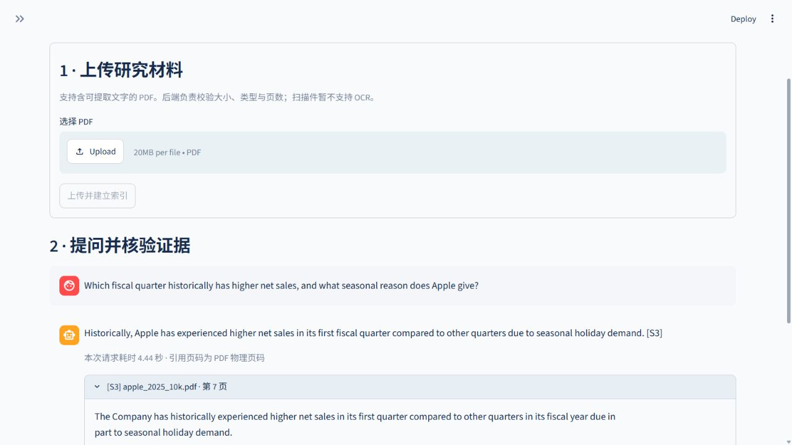
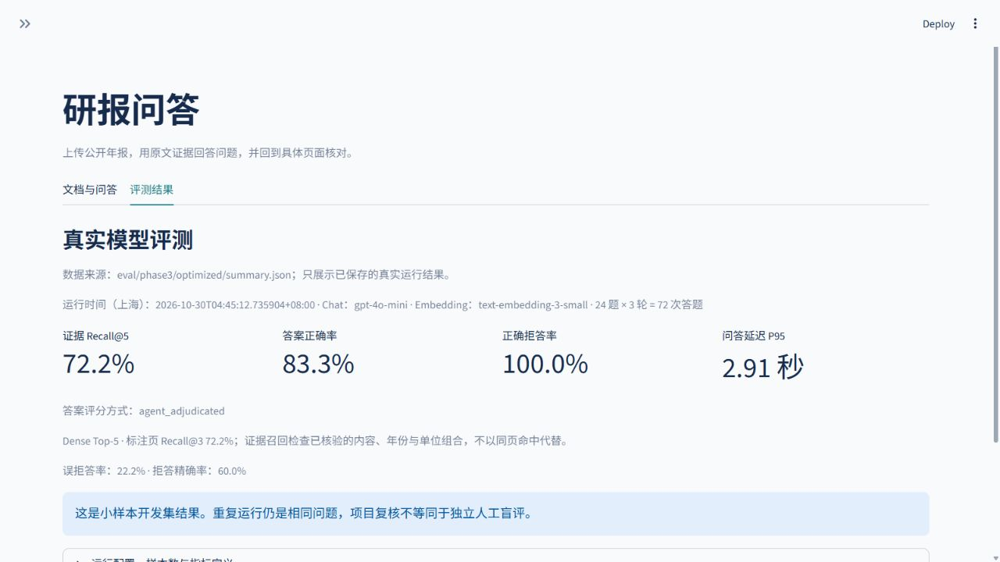

# Phase 3：证据级检索实验与项目收尾

本阶段延续现有应用，范围限于证据级诊断、轻量 dense/hybrid 对比、经诊断支持的提示调整、冻结 A/B 与不同公司 holdout，以及回归和发布前检查。没有增加训练、Agent 框架、数据库或部署服务。

**选定配置：Dense Top-5 + 通用多部分回答/连续表格摘录提示；阈值 0.35、上下文上限 16,000 字符、原文验证器不变、引用修复重试为 0。** 三组配对开发评测、独立公司 holdout、最终回归及发布前检查均已完成。本轮到 Phase 3 为止。

## 历史保护与冻结

- 原始 Apple 24 题、gold 和 Phase 2 `eval/results/` 未重写；[manifest](../eval/phase3/frozen/phase2_manifest.json) 记录内容哈希。
- [evidence_labels.json](../eval/phase3/evidence_labels.json) 是独立证据 sidecar，不反向改动原 gold 页码。
- 检索实验复用原 467 个 chunks 的文本、document ID、chunk ID、页码、metadata 和 embedding。
- [selection.json](../eval/phase3/selection.json) 记录候选及源代码/数据集哈希；[selection_decision.json](../eval/phase3/selection_decision.json) 记录开发集 A/B 后、观察 holdout 前的接受决定。
- 模型固定为 `gpt-4o-mini` / `text-embedding-3-small`。holdout 不参与检索参数、prompt 或验证策略选择。

## 证据级诊断

[retrieval_diagnostics.csv](../eval/phase3/retrieval_diagnostics.csv) 从历史 Top-3 逐项记录问题、chunk ID、文档、物理页、相似度、证据支持、阈值/注入过滤，以及是否需要多个 chunks。该步骤不调用 API。

每题的 requirement 明确需要哪些事实，并以原文确认可接受的等价支持组合。组合可以要求财务行与另一个 chunk 的年份/单位表头共同出现；只命中页码或相同数字不算完整支持。chunk 身份、原文哈希或标签未确认时标为 `requires_review`，不自动猜相关。本轮 18 条可回答题均完成该侧线标注。

| 指标 | 含义 |
| --- | --- |
| Page Recall@k | Top-k 是否命中既有 gold 物理页，不能判断具体 chunk 是否含答案 |
| Evidence Recall@k | 已核验 requirement 中具有完整支持组合的比例，再对有标签的可回答题作宏平均 |
| Answer accuracy | 对最终 claim 的正确性、完整性、单位、时间与引用逐题复核，不由前两项代替 |

历史 Dense Top-3 的标注页召回为 13/18，完整证据支持为 12/18。Page 指标既可能漏计有效替代来源，也可能把缺少关键行的同页 chunk 计为命中。证据标签是人工可审阅、代理辅助核验的规则，不是独立人工盲标，也不保证列尽所有可能的等价来源。

### 对 Phase 2 假设的复核

| 问题 | Phase 3 核验结论 |
| --- | --- |
| a04、a05、a12 | 原始 Top-3 缺少所需证据；增加到 Top-5 仍未完整召回 |
| a13 | 召回了标注页的其他 chunk，但没有 R&D 费用所需财务行；页命中不等于证据命中 |
| a11 | 完整表格、时期和单位在 context 中；新诊断中模型把表格改写为不存在的引文标签，并非单纯空白问题 |
| a16 | 原始 context 缺少总额及完整组成；新诊断出现对少数行求部分和与非连续 quote，不能仅归为引用格式失败 |
| a06 | 所需季度与假日原因在同一证据句中，最终 claim 只回答季度，属于完整性问题 |
| a18 | 数字回答正确，但严格证据标签要求的表格年份表头没有完整到达 context；继续记录这一 grounding 风险 |

原始 failed generations 未保存，所以历史 `a11/a16` 的具体拒绝 quote **不可还原**。[引用诊断](../eval/phase3/citation_investigation.md) 使用单独的新请求重放原始 context，明确标为新观察，不能当作历史原文或受控端到端分数。

## 不调用 Chat 的检索比较（先于端到端 A/B）

这四组实验本身只涉及 embedding 和本地排序，配置选择先于后续端到端 A/B。并行调查中的 4 个定向 chat 诊断请求较早发生，已独立记录在 [引用调查](../eval/phase3/citation_investigation.md)；它们既不是四组检索的计时，也不是历史 raw output 重建或端到端评分。

| 配置 | Page Recall@k | Evidence Recall@k | 通过过滤的相关 chunks，平均 | 平均上下文字符 | 本地排序 mean / P95，毫秒 |
| --- | ---: | ---: | ---: | ---: | ---: |
| Dense Top-3 | 72.22% | 66.67%（12/18） | 1.00 | 2,314.7 | 17.10 / 18.03 |
| Dense Top-5 | 72.22% | 72.22%（13/18） | 1.17 | 3,710.9 | 16.81 / 18.87 |
| Hybrid Top-3 | 50.00% | 66.67%（12/18） | 0.94 | 2,306.6 | 20.90 / 23.14 |
| Hybrid Top-5 | 72.22% | 72.22%（13/18） | 1.39 | 3,799.5 | 20.97 / 22.77 |

精确值见 [retrieval_experiments.json](../eval/phase3/retrieval_experiments.json)、[CSV](../eval/phase3/retrieval_comparison.csv) 和 [逐题检索](../eval/phase3/retrieval_runs.jsonl)。四组复用同一批真实 query vectors，批量 embedding 耗时 3.080 秒单列；表中采用最终保存的本地排序计时，不包含该 API 时间。BM25 冷启动约 0.844 秒也单列。这些局部单次计时不代表完整问答延迟或生产吞吐。

配置选择依据冻结前的首次检索比较，快照保留在 `selection.json`。最终文件为补齐排序 P50/P95，用同一缓存 query vectors 和相同策略/参数补测本地排序，召回判断保持一致；表中计时来自该最终记录。这一步不调用 chat，也不根据 holdout 输出改变选定实现。

Hybrid 使用本地 BM25 与 dense 各 20 个候选，经 `1/(60+rank)` 无权重 RRF 融合，用 `chunk_id` 确定并列。BM25 仅做英文小写词、数字及中文 Han unigram/bigram 的词面匹配，没有词干化、翻译或外部搜索服务。RRF 分数只负责排序；cosine similarity 仍负责相同的 0.35 阈值过滤。

**选择 Dense Top-5，保留 hybrid 负结果。** Hybrid 在两个 k 上均没有增加完整证据召回，未显示值得替换在线默认路径的收益。其代码保留为可选实验接口。Dense Top-5 比 Top-3 多约 **60.3%** 的实际平均上下文，即使 ceiling 相同，仍是更多可用证据的取舍。

## 引用与完整性的有限干预

候选仅追加通用提示：逐项回答问题要求；不把 quote 中的信息当作已在 claim 中作答；财务表格引用复制连续原文；不添加原文没有的标签、数字、时期或单位；缺少完整组成时不推导总额。

输出 schema、source ID 规则、空白兼容的连续片段匹配和显式拒答均不变。没有 citation-repair retry，也没有每次请求的第二次 LLM 调用。“为错误总额找到一个真实 cash-row 引文”仍可能给 unsupported claim 配上出处；当前没有通用语义 eligibility 判定支持安全修复。

## 三组真实配对 A/B

比较 baseline Dense Top-3 + 冻结 Phase 2 QA，与 selected Dense Top-5 + 通用 prompt 组合。问题/variant 顺序交替；每组使用相同题集、gold、模型、评分 rubric、阈值与上下文 ceiling。全部 144 个最终回答及原始生成均已检查并保留逐题复核记录。

这是组合干预，不是单独检索或单独 prompt 的因果实验。每个 variant 的 72 个 question-trials 仍来自同一 **24 条唯一题目**；三次重复用于观察模型波动，不构成 72 条独立测试题。

| 指标 | 新鲜 baseline | selected | 差异 |
| --- | ---: | ---: | ---: |
| Page Recall@3 | 72.22% | 72.22% | 0.00 pp |
| Evidence Recall@3 | 66.67% | 66.67% | 0.00 pp |
| Evidence Recall@selected k | 66.67% | 72.22% | +5.56 pp |
| 可回答题正确率 | 61.11%（33/54） | 77.78%（42/54） | +16.67 pp |
| 总体任务正确率 | 70.83%（51/72） | 83.33%（60/72） | +12.50 pp |
| 误拒答率 | 33.33%（18/54） | 22.22%（12/54） | -11.11 pp |
| 正确拒答率 | 100%（18/18） | 100%（18/18） | 0.00 pp |
| 返回引文有效率（原文出处） | 100%（37/37） | 100%（42/42） | 0.00 pp |
| 原始生成 quote 通过同一验证规则 | 86.05%（37/43） | 100%（42/42） | +13.95 pp |
| 问答 P50 | 1.783 s | 1.893 s | +0.110 s |
| 问答 P95 | 2.520 s | 2.905 s | +0.385 s |

汇总来自 [comparison.md](../eval/phase3/comparison.md)、[baseline](../eval/phase3/baseline/summary.json) 与 [optimized](../eval/phase3/optimized/summary.json)。每次 baseline 都为 17/24 正确，selected 都为 20/24；答案正确与否在三组中一致。延迟仍有波动：baseline 各次 P95 为 2.906/2.450/2.145 秒，selected 为 3.259/2.216/2.354 秒；表中使用各 variant 全部 72 个执行的 pooled 分位数。

### 逐题改进与回归

- `a06`、`a11`、`a16` 在三组中均由错误变为正确，共 9 个配对执行改善。
- 其他 21 个唯一问题中没有答案正确性回归；与 Phase 2 历史正确问题相比也没有观察到正确性回归。
- `a04`、`a05`、`a12`、`a13` 在三组中均继续错误拒答，没有被本轮修改解决。
- `a18` 的答案数字仍正确，但缺失表头的严格支持标签仍为风险；高答案准确率不消除此项问题。

完整变化和解释见 [paired_comparison.csv](../eval/phase3/paired_comparison.csv)。引用有效率的分母是实际返回给用户的引文，验证 ID、metadata 及连续原文，只反映出处，不证明 claim 被语义支持。原始模型 quote 指标使用可解析的捕获输出和相同的空白兼容验证；严格 raw substring 匹配另记为 baseline 21/43、selected 30/42，不混为同一个口径。本轮没有格式无法解析的 generation，分母与全部 72 次生成数单独保存。Phase 2 未保存的 failed quote 指标为 unavailable，不虚构历史值。

## 独立公司 holdout

已准备 [Costco FY2025 12 题](../eval/phase3/holdout_dataset.json)：9 条可回答、3 条应拒答，覆盖财务、会员指标和原因解释。公开 76 页 PDF 的 SHA-256、页码、单位和原文已核验；其 dotted-leader 表格布局不同于 Apple。准备过程未运行 retrieval/chat，也未参与候选选择。

[准备说明](../eval/phase3/holdout_preparation.md) 记录来源、时间和 frozen hash。原 PDF physical page 3 的股东信存在编码提取问题；没有 gold 使用该页，也没有替换原文。实现先冻结、开发集 A/B 接受后才执行 holdout，不根据结果重新调参。

冻结后对两个 variant 各做一次真实运行，12 条唯一问题均有逐题复核。结果单列，不与 Apple 开发集混为整体准确率，也不称为独立人工盲评。

| Costco holdout 指标 | Baseline Dense Top-3 | Selected Dense Top-5 + prompt |
| --- | ---: | ---: |
| Page Recall@3 | 77.78%（7/9） | 77.78%（7/9） |
| Page Recall@selected k | 77.78%（7/9） | 88.89%（8/9） |
| Evidence Recall | unavailable（0/9 verified） | unavailable（0/9 verified） |
| 可回答题正确率 | 55.56%（5/9） | 77.78%（7/9） |
| 总体任务正确率 | 66.67%（8/12） | 83.33%（10/12） |
| 误拒答率 | 44.44%（4/9） | 22.22%（2/9） |
| 应拒答题正确拒答率 | 100%（3/3） | 100%（3/3） |
| 返回引文有效率（原文出处） | 100%（6/6） | 100%（8/8） |
| 捕获 quote 通过同一验证规则 | 77.78%（7/9） | 100%（8/8） |
| 问答 mean / P50 / P95，秒 | 2.187 / 2.235 / 3.066 | 2.255 / 1.973 / 4.251 |
| 实际上下文字符，平均 | 2,226 | 3,675 |
| API 错误 | 0 | 0 |

`h04`（会员费增长原因）与 `h07`（会员/持卡人表格）由错误变为正确，没有观察到答案正确性回归；`h01`（含会员费的总收入）和 `h09`（特定员工群体留任率）仍被误拒答。`h08` 中的库存/劳动效率解释已与真实 source context 核对。`h06` 的中文问题在两个 variant 中均得到英文回答，内容符合参考答案；本轮事实正确性 rubric 没有把语言遵从作为独立评分项，这仍是展示层/模型遵从限制。

详细结果见 [holdout/comparison.md](../eval/phase3/holdout/comparison.md)、[baseline](../eval/phase3/holdout/baseline/summary.json)、[optimized](../eval/phase3/holdout/optimized/summary.json) 和 [冻结检查](../eval/phase3/holdout/freeze_check.json)。该 holdout 没有已完成的 evidence-level sidecar，故证据召回明确为 unavailable；页码指标不能代替它。单次小样本观察不支持一般化或统计显著性结论；selected 的 P95 上升也保留在报告中。

## 复现命令与产物

以下是本轮首次执行的流程记录，在 WSL 仓库目录执行。已保存的 A/B/holdout 审计目录不应原地重新运行；新克隆恢复索引与新的真实评测是两个步骤。

```bash
uv sync --python 3.11 --extra dev --extra demo --locked
uv run python scripts/prepare_eval.py
uv run python scripts/phase3_setup.py --rebuild-index
uv run python scripts/retrieval_diagnostics.py
uv run python scripts/phase3_retrieval.py
uv run python scripts/phase3_freeze.py
uv run python -m research_qa.phase3_evaluation --repeats 3
uv run python scripts/phase3_compare.py --root eval/phase3
```

Fresh clone 不包含被忽略的 PDF 和索引。`prepare_eval.py` 下载并核验固定 PDF；setup 默认复用/复制已有本地索引，显式的 `--rebuild-index` 允许在缺少原索引时调用 `phase3_build_index.py`。helper 先检查 PDF/数据集、模型/provider 指纹和全部 467 个原始 chunk 的 ID、metadata、文本哈希，之后只调用 embedding，不调用 chat。复用和复制同样检查 DB、collection、schema、cosine、fingerprint 与完整 chunk 集合后才报告 ready；失败遗留的不完整目录会保留并报错，现有索引和 frozen 源文件不被覆盖。

已有 run 目录受不覆盖保护；完整复跑须选择新的实验输出根目录，并复制对应的 `qa_phase2.py`、`qa_selected.py` 冻结快照到新根的 `frozen/`，通过 `--output` 指定新目录，不能把“重建索引”当作覆盖历史运行的开关。使用已保存的 selection 和 labels，无需在查看 holdout 后重新冻结或选择参数。比较脚本要求完整逐题复核，`--allow-preliminary` 只用于检查运行中的数据。首次没有 query vector cache 时，检索比较会调用 embedding API，但不调用 chat。

例如，将已接受的相同配置复跑到一个未使用的目录：

```bash
REPLAY_DIR=eval/phase3_replay
mkdir -p "$REPLAY_DIR/frozen"
cp eval/phase3/frozen/qa_phase2.py eval/phase3/frozen/qa_selected.py "$REPLAY_DIR/frozen/"
uv run python -m research_qa.phase3_evaluation \
  --index-dir eval/phase3/workspace/index --output "$REPLAY_DIR" \
  --selection eval/phase3/selection.json --labels eval/phase3/evidence_labels.json \
  --repeats 3
```

新运行有完整 reviews 后才用 `scripts/phase3_compare.py --root "$REPLAY_DIR"` 汇总。真实模型输出可能变化，因此重建兼容向量空间不等于逐字复现历史生成。

Holdout 下载及引用核验不调用模型：

```bash
uv run python scripts/prepare_eval.py \
  --dataset eval/phase3/holdout_dataset.json --pdf-dir eval/pdfs
```

实现冻结且开发集接受决定落盘后，实际使用以下命令。它校验源代码、模型与 holdout 哈希，新建隔离索引，并对两个冻结 variant 各执行一次：

```bash
uv run python scripts/phase3_holdout.py
```

已有 holdout 输出会被保留且拒绝覆盖；没有用通用历史 evaluator 的硬编码 Top-3 替代 selected Top-5。Holdout 没有另建经过完整复核的 evidence-level sidecar，因此其 Evidence Recall 为 unavailable，不能用 Page Recall 代填。

## 验证与 GitHub readiness

2026-10-30（Asia/Shanghai）最终在 WSL 执行：

| 检查 | 实际结果 |
| --- | --- |
| 完整 pytest | **224 passed in 80.06s** |
| Ruff lint | All checks passed |
| Ruff format | 39 files already formatted |
| Phase 2 原始文件 | 16 个哈希全部保持一致 |
| Holdout 后选定 pipeline | 记录的源代码哈希保持不变 |
| 真实路由 smoke | 上传、检索、完整回答、引用、拒答和非法上传均通过 |
| 实际浏览器 | 默认 Top-5、完整季度/假日原因回答、物理 page 7 原文、Evidence Recall@5 卡片及 24 题 × 3 次标签已核验 |
| Fresh clone 索引恢复 | 18 项聚焦测试通过（13.93s）；467 chunks 的现有索引核验通过，空/部分/错误 corpus 保留并明确报错，无 chat 调用 |

记录见 [final_verification.json](../eval/phase3/final_verification.json)。离线测试使用模拟模型调用，不能代替真实 API A/B；真实模型数据与测试分开落盘。本阶段代码停在当前范围，没有扩展为生产系统。

实际浏览器验证截图：





[live_smoke.json](../eval/phase3/live_smoke.json) 已记录 FastAPI TestClient HTTP 路由与真实远程模型 API 的集成检查：公开 Apple PDF 上传返回 201，80 页形成 467 个 chunks；实际生成的回答覆盖季度与假日原因，返回 page 7 原文引用；缺少依据的问题显式拒答；非法上传返回 415。该记录的 `checks_passed` 为 true，不把 TestClient 传输描述成外部网络压测。

忽略规则排除 `.env`/`.env.*`（保留 `.env.example`）、所有 PDF、Chroma/SQLite、实验 workspace、缓存与临时目录。`.gitattributes` 对记录哈希的数据集、实验/历史产物和选定核心源文件使用 `-text`，防止 Git checkout 的 CRLF 自动转换破坏冻结字节哈希；不修改已经评测过的 pipeline。发布前扫描覆盖 prospective publishable 文件、配置中的 key 值和常见 key patterns；不是通用 PII 检测或 Git 历史审计。

[publishability.json](../eval/phase3/publishability.json) 最终记录检查 **167 个可发布候选文件、8 个必要忽略规则 probes、5 个 Git `autocrlf` 字节保护 probes 全部通过、0 个凭据 findings**。字节 probes 在临时 Git 环境验证属性，不初始化项目仓库。可用以下命令重新核验当前文件集合：

```bash
uv run python scripts/check_publishable.py
```

没有执行项目 Git 初始化、staging、commit、创建 remote 或 push。发布需用户明确批准，当前项目仍为本地研究演示。

结论是**具备供人工审阅和准备 GitHub 仓库的材料**：代码、锁定依赖、可复现实验、公开数据来源、逐题记录、测试和忽略规则齐全。它不是通用隐私/安全审计；尚未审计不存在的项目 Git 历史，也不代表具备生产服务能力。用户批准前不执行 GitHub push。

## 本阶段改动文件分组

| 分组 | 文件或生成目录 | 改动用途 |
| --- | --- | --- |
| 在线问答提示 | `src/research_qa/qa.py` | 仅追加通用多部分覆盖与连续财务表格引用规则；验证器保持不变 |
| 演示 | `streamlit_app.py` | 默认 Top-5、优先展示 Phase 3 汇总、区分唯一题与重复执行 |
| 检索与证据评测 | `src/research_qa/retrieval.py`、`evidence.py`、`phase3_evaluation.py` | 可选 BM25/RRF、证据组合判断、冻结配对运行及原始生成审计 |
| 诊断/实验脚本 | `scripts/retrieval_diagnostics.py`、`phase3_setup.py`、`phase3_build_index.py`、`phase3_retrieval.py`、`phase3_freeze.py`、`phase3_compare.py`、`phase3_holdout.py`、`phase3_smoke.py` | 历史保护、新克隆索引恢复、离线比较、冻结、配对汇总、holdout 与真实路由 smoke |
| 发布前检查 | `.gitignore`、`.gitattributes`、`scripts/check_publishable.py` | 私有文件/索引排除、固定字节哈希保护及配置凭据模式检查 |
| 回归 | `tests/test_retrieval.py`、`test_evidence.py`、`test_phase3_qa.py`、`test_phase3_evaluation.py`、`test_phase3_compare.py`、`test_phase3_setup.py`，以及 `test_demo.py` 中的展示用例 | 检索确定性、证据/过滤、引用案例、评分分母、freeze/scope、新克隆恢复和 UI |
| 诊断/选择记录 | `eval/phase3/evidence_*`、`retrieval_*`、`citation_*`、`frozen/`、`selection*.json` | 可追溯的证据、原始来源与选择依据 |
| 真实 A/B | `eval/phase3/baseline/`、`optimized/`、`paired_comparison.csv`、`comparison.md` | 三次配对的逐题回答、review、计时及汇总 |
| Holdout | `eval/phase3/holdout_dataset.json`、`holdout_preparation.md`、`holdout/` | 独立公司题集、冻结核验及单次独立评测 |
| 收尾证据 | `eval/phase3/live_smoke.json`、`publishability.json`、`final_verification.json` | 真实路由、发布候选扫描与最终验证 |
| 文档与截图 | `README.md`、`docs/architecture.md`、`resume.md`、`phase3_results.md`、`phase3-demo-*.jpg` | 当前架构、实测结果、简历材料与浏览器验证 |

原始 `eval/dataset.json`、Phase 2 `eval/results/` 和历史 [evaluation_analysis.md](evaluation_analysis.md) 保持原样；PDF、Chroma/index 和临时 workspace 不在公开产物范围。
